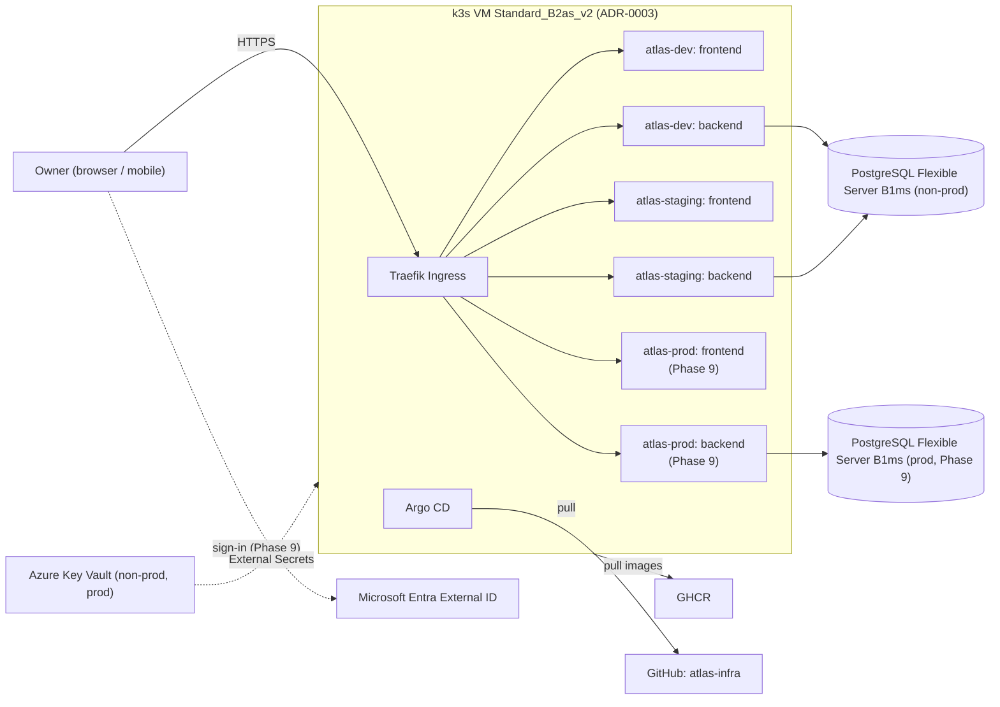

# Plan: Infrastructure and CI/CD (atlas-infra)

- Status: **Phase 0 plan + Phase 1 foundations delivered (2026-11-12)**. Platform, database, identity provider and
  Azure service list decided by the owner on 2026-11-12 ([ADR-0003](../adr/0003-kubernetes-platform.md),
  [ADR-0004](../adr/0004-database-hosting.md), [ADR-0009](../adr/0009-azure-services-and-free-tier.md)); the other
  Proposed ADRs await review.
- Owner: @hsnrzv. Author: platform engineering.
- Source of truth: `atlas/project-instruction.md` §0, §9.4–9.6, §13, §15, §16, §17.4, §18, §19, §21, §22. Also the
  cross-repo setup contract of 2026-11-12.
- Related documents in this repository:
  - [implementation roadmap](../implementation/roadmap.md) (phase order, gates, `INF-…` IDs)
  - [COST-COMPARISON.md](../architecture/COST-COMPARISON.md)
  - [ADRs](../adr/README.md)
  - [runbooks](../runbooks/README.md)
  - [README](../../README.md)
- Related documents in sibling repositories:
  - `atlas`: `docs/plan/IMPLEMENTATION-ROADMAP.md`, `docs/architecture/CONTEXT.md`, `docs/plan/PLAN-FRONTEND.md`.
  - `atlas-microservices`: `docs/plan/PLAN-BACKEND.md`, `docs/plan/PLAN-DATABASE.md`.

> Nothing described here has been applied to a cluster or created in a cloud subscription. Every cloud resource is
> gated on the open decisions in [§ Open decisions](#open-decisions-with-recommended-defaults), and on a budget alert
> existing first.

## Contents

1. [Scope](#scope)
2. [Assumptions](#assumptions)
3. [Environment model](#environment-model)
4. [Infrastructure components](#infrastructure-components)
5. [GitOps structure](#gitops-structure)
6. [Kubernetes operational requirements](#kubernetes-operational-requirements-155)
7. [TLS and ingress](#tls-and-ingress)
8. [Local development stack](#local-development-stack)
9. [CI/CD workflows across the three repositories](#cicd-workflows-across-the-three-repositories)
10. [Image publishing and the automated update PR](#image-publishing-and-the-automated-update-pr)
11. [Promotion flow, database migrations and rollback](#promotion-flow-database-migrations-and-rollback)
12. [Secrets](#secrets)
13. [Backup, restore, RPO/RTO](#backup-restore-rporto)
14. [Security scanning and supply chain](#security-scanning-and-supply-chain)
15. [Observability at minimal cost](#observability-at-minimal-cost)
16. [Mobile release: App Store Connect](#mobile-release-app-store-connect-165)
17. [Budgets and teardown](#budgets-and-teardown)
18. [Proposed packages and files](#proposed-packages-and-files)
19. [Dependencies](#dependencies)
20. [Sequence](#sequence)
21. [Test approach](#test-approach)
22. [Security implications](#security-implications)
23. [Deployment implications](#deployment-implications)
24. [Risks](#risks)
25. [Measurable acceptance criteria](#measurable-acceptance-criteria)
26. [Open decisions with recommended defaults](#open-decisions-with-recommended-defaults)
27. [Backlog (PR-sized)](#backlog-pr-sized)
28. [References](#references)

## Scope

**In scope (atlas-infra):**
- the local full-stack Docker Compose setup;
- Kubernetes manifests (Kustomize bases and overlays for `dev`, `staging`, `prod`);
- the Argo CD AppProject and Applications;
- manifest validation and policy checks, and the infra CI workflow;
- runbooks, the cost comparison and infrastructure ADRs;
- the cross-repo CI/CD and promotion design (§16), including what the application repositories' workflows must do.

**Out of scope here:**
- application code, Dockerfiles and application CI implementation. These are owned by `atlas` and
  `atlas-microservices`. This plan states only the expectations on them.
- identity provider selection (§21 item 1, owned by the cross-repo roadmap; decided 2026-11-12: Microsoft Entra
  External ID). It affects Phase 9 here.
- creating any cloud resource in Phase 0/1.

## Assumptions

- Single owner/operator, single user, low traffic. There is no availability SLA requirement until the owner sets one.
- Azure is the target cloud (project-instruction §15.2).
  - Account: a free account created at the start of Phase 3 and upgraded to pay-as-you-go within the 30-day credit
    period ([ADR-0009](../adr/0009-azure-services-and-free-tier.md)).
  - Region: **Germany West Central** is the Proposed default, supported by the cost data
    ([COST-COMPARISON.md](../architecture/COST-COMPARISON.md)).
- Argo CD GitOps is mandatory, so Kubernetes is required (§15.2).
- Images are published to GHCR under `ghcr.io/hsnrzv/atlas-{frontend,backend}` (contract).
- Backend contract:
  - port 8080, actuator health groups `liveness`/`readiness`, configured by `SPRING_PROFILES_ACTIVE` and
    `SPRING_DATASOURCE_*`;
  - runs as UID 10001 and writes only to `/tmp`;
  - JVM sized with `-XX:MaxRAMPercentage=75`.
  The UID, `/tmp`-only writes and the read-only root filesystem were verified on 2026-11-12.
- Frontend contract: nginx-unprivileged on 8080, UID 101, `/healthz`, SPA fallback, `/api/` returns 404 inside the
  frontend image. Verified on 2026-11-12, including a read-only root filesystem with only `/tmp` and `/var/cache/nginx`
  writable.
- Until authentication exists (Phase 9), no environment may be publicly reachable (§13.1).
- Prices are pay-as-you-go retail prices retrieved 2026-11-12. They must be re-checked before resources are created.

## Environment model

| Environment | Purpose (§15.1) | Runs on | Namespace | Database | Sync | Exposure |
|---|---|---|---|---|---|---|
| `local` | developer machine, integration of all parts | Docker Compose (`local/compose.yaml`) | — | `postgres:18.6-alpine` container, password `atlas` (local only) | — | `127.0.0.1` only |
| `dev` | shared integration of every `main` commit | the k3s VM ([ADR-0003](../adr/0003-kubernetes-platform.md)) | `atlas-dev` | non-prod Flexible Server, database `atlas_dev` | Argo CD automated (prune + self-heal) | allow-listed IPs or tunnel until Phase 9 |
| `staging` | release candidates, E2E acceptance (Phase 4 exit) | the k3s VM | `atlas-staging` | non-prod Flexible Server, database `atlas_staging` | Argo CD manual | allow-listed IPs or tunnel until Phase 9 |
| `prod` | user data | the same k3s VM, from Phase 9 (accepted risk, ADR-0003) | `atlas-prod` | prod Flexible Server, database `atlas` | Argo CD manual | public HTTPS, authentication required |

- `dev`, `staging` and (from Phase 9) `prod` share one cluster as namespaces. This is a documented cost trade-off
  that the owner accepted on 2026-11-12: namespaces are organisational boundaries, not a complete security boundary
  (§15.1).
- Prod is isolated where it matters most, and a separate prod VM remains the upgrade path
  ([ADR-0003](../adr/0003-kubernetes-platform.md)):
  - its own PostgreSQL server and Key Vault;
  - manual sync;
  - from Phase 9, a ResourceQuota on the non-prod namespaces and a higher PriorityClass for prod.
- Every namespace has the Pod Security Admission `restricted` profile and a default-deny ingress NetworkPolicy.



## Infrastructure components

| Component (§15.3) | Proposed choice | Status 2026-11-12 | Decision record |
|---|---|---|---|
| Azure account | free account, upgraded to pay-as-you-go within 30 days; budget first | Accepted; not created (Phase 3) | [ADR-0009](../adr/0009-azure-services-and-free-tier.md) |
| Kubernetes cluster | k3s on one Azure VM Standard_B2as_v2 for dev, staging and prod (namespaces) | Accepted; not created | [ADR-0003](../adr/0003-kubernetes-platform.md) |
| Argo CD | upstream Argo CD (latest release v3.6.1 on 2026-11-04), version pinned at bootstrap | AppProject and Applications written, not applied | [ADR-0002](../adr/0002-gitops-argocd-kustomize-separate-infra-repo.md) (Accepted) |
| Ingress controller + TLS | Traefik bundled with k3s; cert-manager (v1.21.3) with ACME DNS-01 | Ingress manifests written; controller and issuer Proposed | [§ TLS and ingress](#tls-and-ingress) |
| Frontend serving | nginx-unprivileged container behind the same Ingress | manifests written | [ADR-0006](../adr/0006-frontend-hosting.md) |
| Backend | Spring Boot container | manifests written | — |
| PostgreSQL | Azure Database for PostgreSQL Flexible Server, B1ms, PostgreSQL 18: non-prod server (free quota in year 1) and prod server; no `apps/postgres/` | Accepted; not created | [ADR-0004](../adr/0004-database-hosting.md) |
| Secret management | External Secrets Operator (v2.15.0) + Azure Key Vault | Proposed; Secret names and keys fixed | [ADR-0005](../adr/0005-secrets-management.md) |
| Container registry | GHCR | Proposed; sibling workflows build but do not push | [ADR-0007](../adr/0007-image-publishing-and-promotion.md) |
| Blob storage | General Purpose v2, Cool tier, for weekly prod `pg_dump` | Proposed (Phase 9) | [ADR-0004](../adr/0004-database-hosting.md) |
| Metrics/logging | stdout JSON logs + `kubectl logs`/`kubectl top`; Azure Monitor platform metrics and a few alerts; optional Log Analytics within the 5 GB free quota | Proposed | [§ Observability](#observability-at-minimal-cost) |
| DNS | Azure DNS public zone (records, DNS-01) + Private DNS zone (PostgreSQL private access), ≈ 0.45 €/month each | Accepted; domain open | [ADR-0009](../adr/0009-azure-services-and-free-tier.md) |
| Identity provider | Microsoft Entra External ID (external tenant, free up to 50,000 MAU, sign-up disabled) | Accepted; not created (Phase 4–9) | `atlas-microservices` ADR-0005, [ADR-0009](../adr/0009-azure-services-and-free-tier.md) |

## GitOps structure

Packaging is **Kustomize**, rendered by `kubectl kustomize`, with no Helm charts of our own
([ADR-0002](../adr/0002-gitops-argocd-kustomize-separate-infra-repo.md)). The §15.4 recommendation is implemented with
two deliberate refinements:
- bases live in `apps/<component>/base/` instead of a top-level `base/`;
- there is no `apps/postgres/` because the database is managed.

```text
apps/
  backend/base/            Deployment, Service, ServiceAccount, NetworkPolicies, ConfigMap generator
  frontend/base/           Deployment, Service, NetworkPolicies
  ingress/base/            Ingress (/api -> backend, / -> frontend, TLS secret atlas-tls)
  namespace-baseline/base/ default-deny ingress NetworkPolicy
environments/
  dev|staging|prod/
    kustomization.yaml     namespace, labels, profile, image pins (images: newTag/digest)
    namespace.yaml         Namespace with Pod Security Admission `restricted`
    backend/               deployment patch (replicas, resources)
    frontend/              deployment patch (replicas)
    ingress-patch.yaml     host per environment
    pdb.yaml               (prod only) PodDisruptionBudgets
argocd/
  projects/atlas.yaml      AppProject: source repo, 3 destination namespaces, kind whitelists
  applications/            atlas-dev (automated), atlas-staging / atlas-prod (manual)
policies/README.md         enforced and planned policy checks
scripts/validate.sh        render all overlays + image policy + no Secrets + kubeconform
local/                     Docker Compose full stack + edge nginx
```

Image pins currently use the explicit placeholder tag `0.0.0-unreleased`, because no image has been published yet.
`validate.sh` will reject `latest` or a missing tag. Prod additionally requires a digest for any tag other than that
placeholder.

## Kubernetes operational requirements (§15.5)

| Requirement | Status | Where / how |
|---|---|---|
| Resource requests/limits for every workload | [x] | Base deployments; overlays size them per environment. Backend memory limit is 1 GiB because the image uses `MaxRAMPercentage=75`. |
| Readiness/liveness/startup probes | [x] | Backend: `/actuator/health/{liveness,readiness}`, startup budget 150 s. Frontend: `/healthz`. |
| Graceful shutdown + rolling update | [x] | `RollingUpdate` (backend `maxSurge 1 / maxUnavailable 0`), `preStop` sleep 5 s. `terminationGracePeriodSeconds` is 45 (backend) and 20 (frontend). Prod has PDBs with `minAvailable: 1`. |
| Separate config from secrets | [x] | ConfigMap `atlas-backend-config` for non-secret settings; Secret `atlas-backend-db` is referenced, never committed (`validate.sh` fails on any Secret). |
| Network policies | [x] | Default-deny ingress per namespace. Backend: ingress from the ingress controller only; egress limited to DNS and PostgreSQL 5432. Frontend: ingress from the controller only; no egress. The controller namespace is `kube-system` (k3s Traefik). |
| Persistent storage + backup for self-hosted PostgreSQL | n/a | Database is managed ([ADR-0004](../adr/0004-database-hosting.md)); backups in [§ Backup](#backup-restore-rporto). |
| Migration ordering | [ ] Phase 9 | Startup Flyway today; PreSync Job for staging/prod before the first prod deploy ([ADR-0008](../adr/0008-database-migration-execution.md)). |
| Rollback incl. forward-compatible migrations | [~] | Documented (revert the promotion PR, then sync; expand/contract). Rollback runbook and drill in Phase 4. |
| TLS and secure ingress | [~] | Ingress with TLS secret `atlas-tls`; issuer Proposed ([§ TLS and ingress](#tls-and-ingress)). |
| PostgreSQL not public | [~] | Managed server with private access or firewall restricted to the cluster egress IP, TLS required (ADR-0004); no PostgreSQL Service is exposed in the cluster. |
| Hardening beyond the list | [x] | Non-root fixed UIDs (backend 10001, frontend 101), `readOnlyRootFilesystem` with `emptyDir` for `/tmp` (+ `/var/cache/nginx`), drop ALL capabilities, `seccompProfile: RuntimeDefault`, no privilege escalation, `automountServiceAccountToken: false`. |

## TLS and ingress

- **Routing (all environments):**
  - `/api` (Prefix) → `atlas-backend:http`;
  - `/` → `atlas-frontend:http`.
  The frontend image itself returns 404 for `/api/` so routing mistakes are visible. `/actuator/*` is **not** routed
  by the Ingress; probes are in-cluster only. The local edge proxy additionally exposes `/actuator/health` for
  convenience, which is a documented difference.
- **Hosts:** `dev.atlas.example.com`, `staging.atlas.example.com`, `atlas.example.com` are placeholders. The domain is
  an open decision. The Azure DNS zone costs ≈ 0.45 €/month; the domain is bought from an external registrar
  ([ADR-0009](../adr/0009-azure-services-and-free-tier.md)).
- **Controller:** Traefik bundled with k3s (proposed). `ingressClassName` stays unset, so the cluster default class is
  used, until ADR-0003 is accepted.
- **Certificates (Proposed):** cert-manager with Let's Encrypt.
  - Dev and staging are restricted to allow-listed IPs until Phase 9, and HTTP-01 challenges need inbound port 80
    from the internet. Therefore the recommended solver is **DNS-01 with Azure DNS**, authenticated by managed or
    workload identity.
  - HTTP-01 is acceptable for prod once it is public.
  - An overlay adds `cert-manager.io/cluster-issuer: <issuer>` to the Ingress; the Secret `atlas-tls` is then
    issued and renewed automatically.
  - Fallback without cert-manager: import a certificate as `atlas-tls` manually. Not recommended, because renewal
    becomes manual.
- **Later hardening (Phase 9):**
  - HTTP→HTTPS redirect and HSTS via a Traefik middleware;
  - request-size limits;
  - rate limiting on authentication endpoints, if the identity provider does not provide it.
  The frontend already sends CSP, `X-Frame-Options`, `Referrer-Policy` and related headers.

## Local development stack

`docker compose -f local/compose.yaml up --build -d` from this repository root builds both sibling Dockerfiles and
starts four services:
- `postgres` (`postgres:18.6-alpine`, local-only credentials, `pg_isready` healthcheck, named volume);
- `backend` (profile `dev`, explicit `SPRING_DATASOURCE_*`, healthcheck on the readiness endpoint);
- `frontend`;
- `edge` (`nginx:1.30-alpine`) on `127.0.0.1:8000`, mirroring the Ingress routes.

Ports are overridable (`ATLAS_DB_PORT`, `ATLAS_EDGE_PORT`). Validated end to end on 2026-11-12; see the
[runbook](../runbooks/local-development.md).

A local Keycloak (compose profile `auth`) is sketched as a comment only. The deployed identity provider is Microsoft
Entra External ID (decided 2026-11-12). Keycloak stays an optional local test IdP for offline full-stack auth work in
Phase 9.

## CI/CD workflows across the three repositories

| Workflow (§16) | Repository | State 2026-11-12 | Now does | Later (phase) |
|---|---|---|---|---|
| `frontend-ci.yml` | `atlas` | exists | PR + push `main`: `npm ci`, lockfile-registry check, design checks, ESLint, Stylelint, Prettier, Vitest, production build, Playwright, dependency review | Coverage gate; required status check on `main` (owner setting) |
| `frontend-container.yml` | `atlas` | exists (build only) | Builds the runtime image (`push: false`) and smoke-tests health, SPA fallback, headers, API isolation | Phase 2: publish to GHCR on `main` (`main-<sha>`), SBOM + provenance, image scan, bump PR to `atlas-infra` dev ([ADR-0007](../adr/0007-image-publishing-and-promotion.md)) |
| `mobile-validation.yml` | `atlas` | not yet | — | Phase 10 (earlier if Capacitor platforms are added): Capacitor sync, Android build/test, iOS build/test on a macOS runner |
| `mobile-release.yml` | `atlas` | not yet | — | Phase 10: manual, protected `release` environment ([§ Mobile release](#mobile-release-app-store-connect-165)) |
| `backend-ci.yml` | `atlas-microservices` | exists | PR + push `main`: `./mvnw verify` (unit, Spring Modulith architecture, Testcontainers integration tests, with an assertion that they ran), test reports, dependency review | Coverage report and gate; migration compatibility test (N−1 app vs N schema) before Phase 9 |
| `backend-container.yml` | `atlas-microservices` | exists (build only) | Builds the image (`push: false`) and smoke-tests it with PostgreSQL 18 and the health probes | Phase 2/3: publish to GHCR, SBOM + provenance, image scan, bump PR to `atlas-infra` dev |
| `openapi-publish.yml` | `atlas-microservices` | not yet | — | Phase 4 (BE-4.1). The Phase 3 exit criterion "API contract published" is met by the committed snapshot (BE-3.82). This workflow then: version the OpenAPI document, fail on breaking changes against the last release |
| `manifests-ci.yml` | `atlas-infra` | exists | PR + push `main`: `scripts/validate.sh` with kubeconform required, rendered-manifest artifact, shellcheck, `docker compose config`, yamllint | Phase 4: diff of rendered manifests posted on PRs; promotion helper workflow (`workflow_dispatch`) that opens the staging/prod promotion PR |

Conventions for all workflows:
- least-privilege `permissions` (default `contents: read`);
- `concurrency` per ref;
- `persist-credentials: false` on checkout where no push is needed;
- actions pinned to major versions per the contract. Pinning to commit SHAs is recommended once Dependabot is
  maintaining them.
- No workflow holds cluster credentials. Azure access, when it becomes necessary, uses **GitHub OIDC federation**
  with no stored cloud secrets.

## Image publishing and the automated update PR

The design is in [ADR-0007](../adr/0007-image-publishing-and-promotion.md) (Accepted 2026-11-27). In short:

1. A merge to `main` in an application repository runs `*-container`.
   - It builds once and pushes `ghcr.io/hsnrzv/atlas-<app>:main-<12-char sha>` with SBOM and provenance attestations.
   - The image is scanned. Fixable critical vulnerabilities fail the job.
   - `packages: write` is granted only to that job.
2. The workflow opens or updates a PR in `atlas-infra` that sets `newTag` and `digest` for that image in
   `environments/dev/kustomization.yaml`.
   - It uses a GitHub App token scoped to `atlas-infra`.
   - `manifests-ci` validates the PR. Auto-merge for dev-only bump PRs is an owner opt-in.
3. A release adds a semantic version tag `X.Y.Z` to the **same digest**; the image is not rebuilt. `latest` is never
   pushed.

## Promotion flow, database migrations and rollback

```text
PR → CI (app repo) → merge to main → image main-<sha> published → bot PR bumps dev in atlas-infra
   → merge → Argo CD auto-syncs atlas-dev → integration/E2E checks on dev
   → release tag X.Y.Z on the tested digest → PR "promote X.Y.Z to staging" (tag + digest) → review → merge
   → manual sync atlas-staging → PostSync smoke test → E2E acceptance in staging
   → PR "promote X.Y.Z to prod" (digest required, CODEOWNERS approval) → merge → manual sync atlas-prod → smoke test
```

- **Explicit and auditable:** every environment change is a commit in `atlas-infra`, and staging/prod also require a
  human sync. Prod is never deployed because a feature branch merged (§16.3/16.4).
- **Migrations (§16.4, [ADR-0008](../adr/0008-database-migration-execution.md)):**
  - Expand/contract across releases:
    1. add nullable or new elements;
    2. deploy code that handles both shapes;
    3. back-fill separately;
    4. switch reads and writes;
    5. remove old structures in a later release.
  - Execution:
    - Phases 1–4: Flyway at application startup. This is safe with rolling updates only because of expand/contract,
      and concurrent replicas are serialised by Flyway's PostgreSQL advisory lock.
    - Before the first prod deploy: staging and prod switch to an Argo CD **PreSync hook Job** that runs the same
      image in migrate-only mode with a DDL-owning role. The app then runs with a DML-only role and Flyway disabled.
  - Hook credentials come from a separate per-environment secrets Application synced first, because a PreSync hook
    runs before the Application's own resources.
- **Sync phases and waves (planned; no wave annotations are set yet):**
  - Separate secrets Application first, so ExternalSecrets have produced their Secrets.
  - Then `PreSync`: migration Job (staging/prod, Phase 9).
  - Then `Sync`: ConfigMaps in wave `-1`; Deployments, Services and Ingress in wave `0`.
  - Then `PostSync`: smoke-test Job.
  - Argo CD orders by phase, then by wave in ascending order, and moves on only when the current wave is synced and
    healthy.
- **Rollback:**
  1. Revert the promotion commit and manually sync. The previous image works against the expanded schema.
  2. If a migration itself is faulty, roll forward with a fix migration.
  3. Point-in-time restore is the last resort, because it loses writes made after the restore point.
  - The rollback runbook and a staging drill are Phase 4 items.

## Secrets

- The design is in [ADR-0005](../adr/0005-secrets-management.md) (Proposed): Azure Key Vault (one vault for non-prod,
  one for prod) plus External Secrets Operator. Workload identity is preferred; the VM managed identity is the
  fallback on k3s.
- Contracted Secrets:
  - `atlas-backend-db` (`SPRING_DATASOURCE_URL`, `SPRING_DATASOURCE_USERNAME`, `SPRING_DATASOURCE_PASSWORD`);
  - `atlas-tls`;
  - later `atlas-backend-db-migrator` (Phase 9), OIDC client settings (Phase 9), and `ghcr-pull` if packages stay
    private.
- Nothing secret is committed. `validate.sh` fails on any rendered `Secret`, and `.gitignore` excludes `.env`,
  decrypted files and kubeconfigs. GitHub Actions secrets are only:
  - the GitHub App credentials for the bump PRs, in the application repositories;
  - mobile signing material in the protected `release` environment (Phase 10).
- Rotation: update the value in Key Vault, let ESO refresh it, then restart the Deployment. The runbook is a Phase 9
  item.

## Backup, restore, RPO/RTO

This is the proposal for §21 item 11. Facts are from Microsoft Learn, accessed 2026-11-12.
- Flexible Server takes daily backups plus continuous transaction-log backups, retained for 7–35 days, with
  point-in-time restore.
- Microsoft's typical figures for PITR are "RPO < 5 minutes" and an RTO that "varies". The RTO depends on data size
  and log recovery and can be "from a few minutes up to 12 hours".
- High availability (zone-redundant or same-zone) is only for the General Purpose and Memory Optimized tiers, not
  Burstable.

| | Non-prod (dev, staging) | Prod |
|---|---|---|
| Mechanism | Flexible Server PITR | Flexible Server PITR **plus** weekly encrypted `pg_dump` to Blob Storage (Cool, separate storage account, lifecycle policy, versioning/soft delete) |
| Retention | 7 days (default) | PITR 35 days; logical dumps 12 weeks |
| Target RPO | best effort (data is disposable) | **≤ 5 minutes** for PITR scenarios. **≤ 7 days** if the server and its backups are lost and the logical dump is the only source. |
| Target RTO | best effort | **≤ 4 hours** for the typical case at this data size, to be measured in drills. Worst case is bounded by the service (up to 12 hours). Cluster rebuild (stateless node) **≤ 2 hours**, also to be measured. |
| Cost | included (backup storage free up to 100% of provisioned storage) | included, plus Blob Cool 0.0090 €/GB-month: < 1 €/month for a few GB of dumps |
| Drill | — | Restore into a disposable server before Phase 9 exit, then quarterly. Point a backend at it, run the smoke tests, record timings in the runbook, delete the server. |

There is no cluster-state backup by design: manifests are in Git, secrets in Key Vault, data in PostgreSQL. Cluster
recovery means recreating the VM and running the bootstrap runbook, which must be rehearsed before prod (Phase 9).

## Security scanning and supply chain

| Control | Where | Status |
|---|---|---|
| Dependency review on PRs | `frontend-ci`, `backend-ci` (`actions/dependency-review-action@v5`) | exists |
| Dependabot version updates | all three repositories (`.github/dependabot.yml`). Here: GitHub Actions and the compose images; postgres major updates ignored. | exists (takes effect after push) |
| Dependabot security alerts | repository settings | owner to enable after first push |
| Secret scanning + push protection | repository settings. Availability for private repositories depends on the GitHub plan: to verify. | owner to enable |
| Container image scan | `*-container` workflows (Trivy or Grype, pinned) | Phase 2/3 |
| SBOM + provenance | `docker/build-push-action` (`sbom: true`, `provenance: mode=max`) | Phase 2/3 |
| Manifest policy | `scripts/validate.sh`: tags, digests in prod, no Secrets, kubeconform strict | exists |
| Static analysis (CodeQL or equivalent) | application repositories. Availability for private repositories depends on the GitHub plan: to verify. | proposed, Phase 3 |
| Cloud authentication from CI | GitHub OIDC → Entra workload identity federation; no long-lived cloud secrets | when first needed |
| Image signature verification at admission | — | not planned before Phase 10 |

Definition of Done (§19): CI passes, and no new critical or high vulnerability is ignored without a documented
exception, recorded in the PR and in the scanner's ignore file with an expiry date.

## Observability at minimal cost

- **Logs:** structured JSON to stdout outside the `local` profile (backend contract), read with `kubectl logs`.
  - Log Analytics ingests the first 5 GB per month free, then 2.68 €/GB
    ([ADR-0009](../adr/0009-azure-services-and-free-tier.md)).
  - An optional workspace with a 0.15 GB daily cap may collect PostgreSQL and activity logs.
  - Container logs are not shipped until there is a concrete need.
- **Metrics:** `kubectl top` via metrics-server. k3s deploys it as a packaged component, alongside coredns, traefik
  and local-storage ([k3s packaged components](https://docs.k3s.io/installation/packaged-components), accessed
  2026-11-12).
- **Alerting:**
  - Argo CD sync and health status, with Argo CD notifications to e-mail as an optional Phase 9 item;
  - Azure budget and anomaly alerts;
  - Azure Monitor metric alerts on platform metrics (VM CPU credits and availability, PostgreSQL storage and CPU),
    at cents per alert rule;
  - an uptime check of the prod `/healthz` (Phase 9): an Application Insights standard test (billed per run) or a
    free external monitor; choose in Phase 9.
- **Backend metrics:** application metrics (Micrometer/Prometheus) are not exposed today (`health,info` only). Adding
  a Prometheus stack is deferred until there is a concrete need, because of its memory cost on a single node.

## Mobile release: App Store Connect (§16.5)

This is Phase 10 and lives in `atlas` (`mobile-release.yml`). It is listed here because it is part of the CI/CD design.

- Trigger: `workflow_dispatch` only. The job targets the protected GitHub environment **`release`**, which requires
  approval by the owner.
- Runner: a macOS GitHub-hosted runner for iOS build, signing and upload. Fastlane or the current supported App Store
  Connect tooling is chosen and version-pinned in that PR.
- Secrets live only in the `release` environment:
  - App Store Connect API key (issuer ID, key ID, `.p8` contents);
  - signing certificate (`.p12`) and its password;
  - provisioning profile.
  Nothing goes in repository files or logs. A temporary keychain is created per run and deleted afterwards.
- Release configuration is explicit, versioned input: bundle identifier, marketing version, build number (monotonic,
  e.g. derived from the run number), privacy declarations, icons, screenshots, export compliance.
- Android is built and tested separately in `mobile-validation.yml`. A Google Play release is added only when
  requested; App Store Connect does not deploy Android.
- CI can upload to TestFlight/App Store Connect, but store review and approval are external (§16.5).

## Budgets and teardown

The full procedure is in [COST-COMPARISON.md](../architecture/COST-COMPARISON.md#budget-alerts-and-teardown-before-any-resource-is-created).
Rules for this plan:
1. **The budget comes first.** Create a subscription budget (estimate + 20%), with alerts at 50/80/100% actual and
   100% forecast, plus cost anomaly alerts, **before** the first resource exists.
2. One resource group per environment group (`rg-atlas-nonprod`, `rg-atlas-prod`), with tags `project`,
   `environment`, `owner`.
3. Expected run rate (ADR-0003/0004 accepted; [ADR-0009](../adr/0009-azure-services-and-free-tier.md)):
   - Phases 3–8 (VM + non-prod PostgreSQL): ≈ **61 €/month** in the free year, ≈ **88 €/month** after it;
   - from Phase 9 (prod namespace + prod PostgreSQL): ≈ **78 €/month** in the free year, ≈ **105 €/month** after it.
   Both include DNS and exclude VAT. Budget: 75 €, then 125 €. Raise it before month 13.
4. Pause non-prod: deallocate the VM and stop the PostgreSQL server. It restarts automatically after seven days.
   Teardown: `az group delete`, then check for soft-deleted Key Vaults and leftover disks or IPs.
5. Phase 9 adds a "resource cleanup automation" item (§18): a scheduled check, read-only via OIDC, that lists
   untagged or unexpected resources.

## Proposed packages and files

Delivered in Phase 1: see [§ Backlog](#backlog-pr-sized). Planned additions; folders are created only when they get
content:

| Path | Phase | Purpose |
|---|---|---|
| `docs/runbooks/cluster-bootstrap.md` + `bootstrap/` (pinned k3s, Argo CD and add-on install) | 3 | create or recreate a cluster reproducibly |
| `argocd/applications/atlas-<env>-secrets.yaml`, `environments/<env>/secrets/` (SecretStore, ExternalSecret) | 3 | secrets via ESO ([ADR-0005](../adr/0005-secrets-management.md)) |
| `environments/<env>/certificates/` or issuer annotations | 3 | cert-manager DNS-01 |
| `environments/staging/smoke-test-job.yaml` (PostSync hook) | 4 | post-sync smoke test (§17.4) |
| `.github/workflows/promote.yml` (`workflow_dispatch`) | 4 | open promotion PRs that copy the tag and digest |
| `environments/{staging,prod}/migration-job.yaml` (PreSync hook) | 9 | migrations before rollout ([ADR-0008](../adr/0008-database-migration-execution.md)) |
| `docs/runbooks/{backup-restore,rollback,secret-rotation,teardown}.md` | 4/9 | operations |

Third-party tools are recorded in [THIRD-PARTY-NOTICES.md](../../THIRD-PARTY-NOTICES.md) with version and licence
when they are introduced.

## Dependencies

- **Owner decisions:**
  - ADR-0005, 0006, 0007 and 0008; region; domain name; GHCR package visibility; LICENSE.
  - Already decided 2026-11-12: ADR-0003, 0004 and 0009, the account type and the identity provider.
- **`atlas-microservices`:**
  - container publishing and the bump PR (Phase 2/3);
  - migrate-only mode and the two database roles (before Phase 9);
  - an OpenAPI artifact (Phase 3);
  - keep port 8080, the actuator groups, UID 10001 and `/tmp`-only writes.
- **`atlas`:**
  - container publishing and the bump PR (Phase 2);
  - keep `/healthz`, UID 101, port 8080, `/api/` → 404 and a public-registry lockfile;
  - `mobile-*` workflows (Phase 10).
- **GitHub:**
  - a GitHub App (or fine-grained token) for cross-repo PRs;
  - branch protection with required checks;
  - Dependabot alerts and secret scanning settings;
  - the protected `release` environment (Phase 10).
- **Azure:** a subscription with a budget, then the resources per the accepted ADRs.

## Sequence

1. Phase 0/1 (done): plans, ADRs, local stack, manifests, validation, CI.
2. Owner review: ADR-0003, 0004 and 0009 accepted on 2026-11-12; accept or adjust ADR-0005…0008, region, domain.
3. Phase 2: image publishing to GHCR and dev bump PRs. Optionally, rehearse an Argo CD sync on a throw-away local
   cluster (kind or k3d) at no cloud cost.
4. Phase 3:
   1. free account (then pay-as-you-go), budget and alerts;
   2. non-prod resource group;
   3. k3s VM bootstrap with Argo CD, ESO and cert-manager;
   4. non-prod PostgreSQL;
   5. Key Vault;
   6. `atlas-dev` live (allow-listed);
   7. OpenAPI publishing.
5. Phase 4: `atlas-staging` live; PostSync smoke test; E2E against staging (Phase 4 exit); promotion workflow;
   rollback drill.
6. Phase 9:
   1. identity provider (Entra External ID external tenant; sign-up disabled);
   2. prod namespace with quotas and priority, prod PostgreSQL and Key Vault;
   3. migration Job;
   4. public TLS;
   5. backups and restore drill;
   6. runbooks;
   7. threat model;
   8. cleanup automation;
   9. first prod promotion.
7. Phase 10: mobile workflows and the `release` environment.

## Test approach

| §17.4 requirement | How | When |
|---|---|---|
| Validate manifests in CI | `scripts/validate.sh`: render every overlay, image policy, no Secrets, kubeconform `-strict` against Kubernetes 1.37 schemas and pinned CRD schemas for Argo CD | now (`manifests-ci`) |
| Container health checks and startup ordering | Compose `depends_on: condition: service_healthy` (postgres → backend → edge), container healthchecks, and the sibling container-workflow smoke tests. In clusters: probes and Argo CD waves and hooks. | now (local, CI); Phase 3+ (cluster) |
| Scan containers and dependencies | dependency review now; image scan with publishing | now / Phase 2–3 |
| Staging smoke test after Argo CD sync | PostSync hook Job: `GET /healthz` through the frontend Service; backend readiness through the backend Service; `GET /api/v1/...` through the Ingress | Phase 4 |
| Backup restoration in a disposable environment | PITR into a new server, smoke test, delete; timings recorded | Phase 9, then quarterly |
| Rollback and migration compatibility | Revert-and-sync drill in staging; backend CI test running the previous release against the new schema | Phase 4 (drill), before Phase 9 (CI test) |

## Security implications

- No secrets in Git: Secret names are a contract and values come from Key Vault. Local-only credentials (`atlas`) are
  labelled and bound to `127.0.0.1`.
- Pull-based GitOps: CI never holds cluster credentials. Argo CD's AppProject restricts the source repository,
  destination namespaces and resource kinds.
- Workloads run under PSA `restricted` with non-root fixed UIDs, a read-only root filesystem, no capabilities and
  `RuntimeDefault` seccomp. Service account tokens are not mounted.
- Network: default-deny ingress, explicit egress for the backend (DNS + PostgreSQL), no egress for the frontend.
  PostgreSQL is never public. The VM NSG allows only 80/443. Administrative access is restricted to allow-listed IPs
  or uses Azure Run Command or Bastion.
- No public exposure before authentication (§13.1). Prod is public only with authentication (Phase 9 exit).
- Supply chain: immutable tags and digests, SBOM, provenance, scans, Dependabot.
- Threat model review in Phase 9.

## Deployment implications

- The backend cannot start in a cluster until `atlas-backend-db` exists (ESO, Phase 3). This is intentional: there is
  no fallback to committed credentials.
- The `0.0.0-unreleased` placeholders must be replaced by the first real tags and digests. Prod refuses
  non-placeholder tags without a digest.
- The NetworkPolicies assume the ingress controller runs in `kube-system` (k3s Traefik). Another controller requires
  patching the selectors.
- The AppProject whitelist must grow with new kinds: `batch/Job` (Phase 4/9), the ESO kinds (Phase 3), and the
  cert-manager `Certificate` kind if used.
- Single-node clusters mean maintenance windows cause downtime. PDBs (prod, `minAvailable: 1`) protect only against
  voluntary disruptions on multi-replica deployments.

## Risks

| Risk | Impact | Mitigation |
|---|---|---|
| Single k3s node: failure or maintenance takes the environment down | downtime | stateless node, rehearsed rebuild (≤ 2 h target); revisit AKS Standard if an SLA is needed |
| Prod shares the node with dev and staging (owner-accepted, ADR-0003) | non-prod starves or, after an escape, reaches prod | PSA `restricted`, NetworkPolicies, non-prod ResourceQuota, prod PriorityClass, separate prod database and Key Vault; move prod to its own VM on the ADR-0003 triggers |
| Free year ends (month 13) | bill rises by ≈ 27 €/month | budget raised to 125 €, reminder at month 12 ([ADR-0009](../adr/0009-azure-services-and-free-tier.md)) |
| B-series CPU credits exhausted | slow or unavailable non-prod | monitor credits; move to D2as_v5 (+11.54 €/month) |
| Memory pressure (dev + staging + prod + controllers on 8 GiB) | evictions | requests sized; measure with `kubectl top` after bootstrap; non-prod ResourceQuota; prod on its own VM if pressure is measured |
| Migration incompatible with the running version | errors during rollout, failed rollback | expand/contract rule, N−1 compatibility test, PreSync Job for staging/prod |
| Cost overrun / forgotten resources | unexpected bill | budget first, anomaly alerts, tagging, teardown procedure, cleanup automation (Phase 9) |
| Workload identity on k3s needs a public OIDC issuer | setup complexity | VM managed identity fallback ([ADR-0005](../adr/0005-secrets-management.md)) |
| Private registry or mirror leaking into lockfiles | CI and image builds fail outside the corporate network | `atlas` CI checks that the lockfile resolves only from the public npm registry; Maven Wrapper uses Maven Central |
| Prices and versions drift | stale estimates | re-run the documented price queries and version checks before creating resources |
| Exposure before authentication exists | data exposure | NSG allow-list or tunnel for dev and staging; prod only after the Phase 9 exit criteria are met |

## Measurable acceptance criteria

Phase 0/1 (this delivery):

- [x] `scripts/validate.sh` renders `dev`, `staging` and `prod` without errors. kubeconform `-strict` reports 0
      invalid resources, with Argo CD CRDs validated. No `latest` or untagged images; no rendered `Secret`.
- [x] `docker compose -f local/compose.yaml config -q` succeeds. `up --build` with both sibling Dockerfiles brings all
      four services to healthy. Through the edge: `GET /` returns the SPA, `GET /actuator/health` returns
      `{"status":"UP"}`, and `/api/*` reaches the backend (verified 2026-11-12).
- [x] shellcheck and `yamllint --strict` pass.
- [x] Plan, cost comparison with retrieval date and queries, ADRs 0001–0008 with an index, and runbook index exist.

Later phases:

- Phase 3:
  - the dev URL serves the app only to allow-listed clients;
  - Argo CD shows `atlas-dev` Synced/Healthy;
  - a `main` merge reaches dev without manual edits (bot PR → merge → auto-sync) within 30 minutes.
- Phase 4:
  - the staging promotion is a reviewed PR plus a manual sync;
  - the PostSync smoke test passes;
  - E2E passes against staging;
  - a rollback drill restores the previous version within 15 minutes.
- Phase 9:
  - prod requires authentication;
  - a restore drill is completed and its timings recorded (RTO met);
  - budget alerts are active;
  - all runbooks listed in the index exist.

## Open decisions with recommended defaults

| # | Decision | Recommended default | Main trade-off | Record |
|---|---|---|---|---|
| §21.2 | Kubernetes platform | **Decided 2026-11-12:** k3s on one B2as_v2 VM for dev, staging and (from Phase 9) prod as namespaces. ≈ 61 → 88 €/month, with prod ≈ 78 → 105 €/month (free year → after). | Lowest cost with Argo CD, but no control-plane SLA, self-managed upgrades and prod sharing a node with non-prod (accepted risk). Separate prod VM ≈ 149 → 186 €/month; AKS Free + Standard ≈ 725 €/month. | [ADR-0003](../adr/0003-kubernetes-platform.md) |
| §21.3 | Database hosting | **Decided 2026-11-12:** Flexible Server B1ms, PostgreSQL 18: one non-prod server (free quota in year 1) and one prod server, not public | 17 €/month per server for managed PITR backups vs ≈ 0 € extra but a stateful node and our own backups if self-hosted | [ADR-0004](../adr/0004-database-hosting.md) |
| §21.4 | Frontend hosting | nginx container behind the same Ingress; Argo CD deploys it like the backend | Simplest GitOps and same-origin `/api` (no CORS), vs a static host's CDN and zero server cost but a second deployment path outside Argo CD | [ADR-0006](../adr/0006-frontend-hosting.md) |
| §21.10 | Production secrets | Key Vault + External Secrets Operator; workload identity, with VM managed identity as fallback | Rotation without commits and audit, vs an extra operator. SOPS/Sealed Secrets keep ciphertext in Git and tie it to cluster keys. | [ADR-0005](../adr/0005-secrets-management.md) |
| §21.11 | Backup/restore | PITR 35 days (prod), 7 days (non-prod); weekly prod `pg_dump` to Blob Cool, 12 weeks; RPO ≤ 5 min, RTO ≤ 4 h target; quarterly drill | Near-zero extra cost; no HA (Burstable), so restore is the recovery path | [§ Backup](#backup-restore-rporto) |
| — | Azure region | Germany West Central: identical prices to West Europe for the recommended option, cheaper Container Apps | Some services (e.g. Static Web Apps pricing) only returned for West Europe; verify availability before creating resources | [COST-COMPARISON.md](../architecture/COST-COMPARISON.md) |
| — | Account / subscription type | **Decided 2026-11-12:** free account at the start of Phase 3, upgraded to pay-as-you-go within 30 days; budget first. Free quotas save ≈ 27 €/month in year 1. | Free-account services expire after 12 months; budget raised before month 13 | [ADR-0009](../adr/0009-azure-services-and-free-tier.md) |
| — | Image publishing and promotion | GHCR, `main-<sha>` + `X.Y.Z` tags on the same digest, bot PR for dev, reviewed PR + manual sync for staging/prod | One extra cross-repo credential (GitHub App) | [ADR-0007](../adr/0007-image-publishing-and-promotion.md) |
| — | Migration execution | Startup Flyway until Phase 9; PreSync Job with a separate DDL role for staging/prod from Phase 9 | Simplicity now vs least privilege and clean failure later; needs a backend migrate-only mode | [ADR-0008](../adr/0008-database-migration-execution.md) |
| — | GHCR package visibility | Private until the owner decides repository visibility; pull Secret via ESO | Private needs `ghcr-pull`; public needs none | [ADR-0007](../adr/0007-image-publishing-and-promotion.md) |
| — | Domain and TLS issuer | Owner-chosen domain; Azure DNS + cert-manager DNS-01 (works with IP allow-lists) | ≈ 0.45 €/month DNS zone plus the registrar fee vs manual certificates | [§ TLS and ingress](#tls-and-ingress) |
| — | LICENSE | No LICENSE file until the owner decides (contract rule) | Without a license, others have no reuse rights; fine for a private project | README |
| §21.1 (input only) | Identity provider | **Decided 2026-11-12:** Microsoft Entra External ID (free up to 50,000 MAU). Infra impact: OIDC configuration (issuer, client IDs) in Phase 9; no IdP workload in the cluster; Keycloak stays an optional local test profile. | — | `atlas` roadmap, `atlas-microservices` ADR-0005, [ADR-0009](../adr/0009-azure-services-and-free-tier.md) |

## Backlog (PR-sized)

IDs are stable for cross-referencing; the order and gates are in the
[implementation roadmap](../implementation/roadmap.md).

### Phase 1 — Foundations (this repository)

- [x] **INF-1.1** Repository hygiene: README, CONTRIBUTING, SECURITY, THIRD-PARTY-NOTICES, `.editorconfig`, `.gitattributes`,
      `.gitignore`, CODEOWNERS, PR template, Dependabot
- [x] **INF-1.2** Local full stack: `local/compose.yaml` (postgres, backend, frontend, edge), edge nginx config, `.env.example`,
      local README. Verified end to end on 2026-11-12.
- [x] **INF-1.3** Kustomize bases: backend, frontend, ingress, namespace baseline (probes, resources, securityContext,
      NetworkPolicies)
- [x] **INF-1.4** Overlays: `dev`, `staging`, `prod` (namespaces with PSA `restricted`, replicas, resources, hosts, image pins,
      prod PDBs)
- [x] **INF-1.5** Argo CD AppProject and Applications (dev automated, staging/prod manual). Not applied.
- [x] **INF-1.6** `scripts/validate.sh` and `policies/README.md` (tag and digest policy, no Secrets, kubeconform)
- [x] **INF-1.7** `manifests-ci.yml` (validate, shellcheck, compose config, yamllint; pinned tool checksums)
- [x] **INF-1.8** Docs: this plan, COST-COMPARISON, ADR-0001…0008 + index + template, runbook index + local development runbook
- [x] **INF-1.9** ADR-0009 (Azure services and free tier); ADR-0003 and 0004 accepted (owner, 2026-11-12)
- [ ] **INF-1.10** First push and first green `manifests-ci` run on GitHub (pushed to `origin/main` by 2026-11-26; green run
      to be confirmed)
- [ ] **INF-1.11** Branch protection on `main` with `manifests-ci` required; enable Dependabot alerts and secret scanning (owner,
      GitHub settings)

### Phase 2 — Publishing (no cloud cost)

- [ ] **INF-2.1** `atlas`: `frontend-container` publishes `main-<sha>` to GHCR with SBOM, provenance and scan (F2-11, F2-12)
- [x] **INF-2.2** `atlas-microservices`: `backend-container` publishes `main-<sha>` to GHCR with SBOM, provenance and scan
      (BE-1.13, BE-2.4)
- [ ] **INF-2.3** GitHub App for cross-repo PRs; bump-PR job in both container workflows targeting `environments/dev`
      (App and backend job done 2026-11-27, with auto-merge; the frontend job is open with F2-12)
- [ ] **INF-2.4** Optional: local kind/k3d rehearsal of the Argo CD Applications against this repository (documented, not CI)
- [ ] **INF-2.0** Owner decisions recorded: ADR-0005…0008 accepted or amended; region; domain

### Phase 3 — Non-prod platform and dev environment

- [ ] **INF-3.1** Azure free account (then pay-as-you-go upgrade within 30 days), budget 75 €, anomaly alerts,
      `rg-atlas-nonprod` with tags (before any other resource)
- [ ] **INF-3.2** Azure DNS public zone for the owner's domain; Private DNS zone for PostgreSQL
- [ ] **INF-3.3** Cluster bootstrap runbook + pinned bootstrap (k3s, Argo CD, ESO, cert-manager) on the B2as_v2 VM; NSG
      allow-list
- [ ] **INF-3.4** Non-prod PostgreSQL Flexible Server (`atlas_dev`, `atlas_staging`, separate logins, not public)
- [ ] **INF-3.5** Key Vault (non-prod) + `atlas-dev-secrets` Application (SecretStore, ExternalSecrets); AppProject whitelist
      update
- [ ] **INF-3.6** TLS: ClusterIssuer (DNS-01) + `atlas-tls` for dev; `ingressClassName` set
- [ ] **INF-3.7** Apply the AppProject and `atlas-dev`; first automated sync; verify probes and NetworkPolicies on the real
      controller

### Phase 4 — Staging and promotion

- [ ] **INF-4.1** `atlas-microservices`: `openapi-publish.yml` (BE-4.1)
- [ ] **INF-4.2** `atlas-staging` live (manual sync) with secrets and TLS
- [ ] **INF-4.3** PostSync smoke-test Job for staging (AppProject: `batch/Job`)
- [ ] **INF-4.4** `promote.yml` workflow: open a promotion PR copying the tag and digest dev → staging (and later staging → prod)
- [ ] **INF-4.5** E2E suite runs against staging (Phase 4 exit criterion)
- [ ] **INF-4.6** Rollback runbook + drill in staging (revert promotion, sync, verify)
- [ ] **INF-4.7** Rendered-manifest diff on `atlas-infra` PRs

### Phase 9 — Production (outline)

- [ ] **INF-9.1** Identity provider integrated (Entra External ID external tenant, sign-up disabled); no unauthenticated public
      route
- [ ] **INF-9.2** Prod namespace on the shared VM: ResourceQuota on `atlas-dev`/`atlas-staging`, PriorityClass for prod
- [ ] **INF-9.3** Prod PostgreSQL (35-day PITR), prod Key Vault, public TLS, HSTS/redirect; budget raised to 125 €
- [ ] **INF-9.4** Uptime check of prod `/healthz` (Application Insights standard test or a free external monitor)
- [ ] **INF-9.5** Migration PreSync Job with a separate DDL role (staging first, then prod); backend migrate-only mode
- [ ] **INF-9.6** Weekly `pg_dump` to Blob Cool; restore drill completed and timed; backup/restore runbook
- [ ] **INF-9.7** Runbooks: secret rotation, teardown, cluster rebuild (rehearsed)
- [ ] **INF-9.8** Threat model review; scans gating with a documented exception process
- [ ] **INF-9.9** Cost cleanup automation; first prod promotion (digest-pinned, manual sync)

### Phase 10 — Mobile release (outline)

- [ ] **INF-10.1** `mobile-validation.yml` (Android build/test; iOS build/test on macOS)
- [ ] **INF-10.2** Protected `release` environment with required reviewer; App Store Connect API key and signing material stored
      there
- [ ] **INF-10.3** `mobile-release.yml` (manual dispatch, TestFlight/App Store Connect upload, explicit release configuration)

## References

All accessed 2026-11-12.

- project-instruction.md §13, §15, §16, §17.4, §18, §19, §21
- Azure Retail Prices API and Microsoft Learn sources: see [COST-COMPARISON.md](../architecture/COST-COMPARISON.md)
- Business continuity in Azure Database for PostgreSQL Flexible Server (RPO/RTO, HA tiers): https://learn.microsoft.com/en-us/azure/postgresql/backup-restore/concepts-business-continuity
- Backup and restore in Flexible Server: https://learn.microsoft.com/en-us/azure/postgresql/flexible-server/concepts-backup-restore
- Argo CD sync phases and waves: https://argo-cd.readthedocs.io/en/stable/user-guide/sync-waves/
- k3s requirements: https://docs.k3s.io/installation/requirements; packaged components: https://docs.k3s.io/installation/packaged-components
- External Secrets Operator, Azure Key Vault provider: https://external-secrets.io/latest/provider/azure-key-vault/
- Kustomize images transformer: https://kubectl.docs.kubernetes.io/references/kustomize/kustomization/images/
